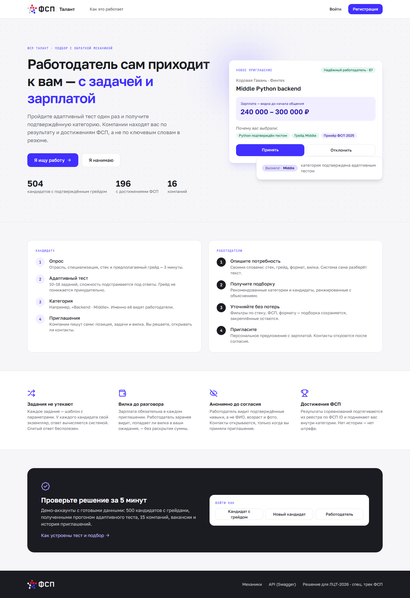
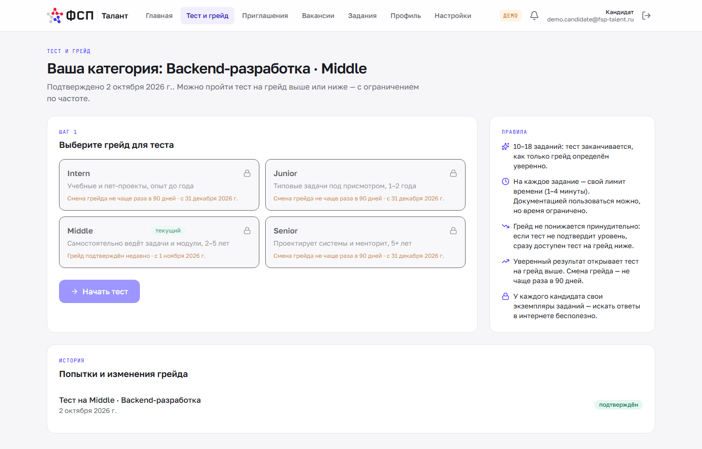
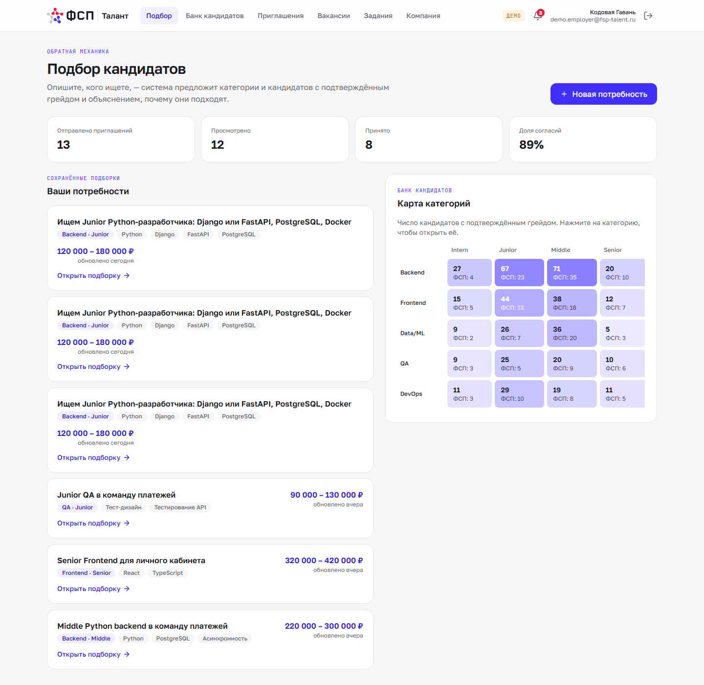
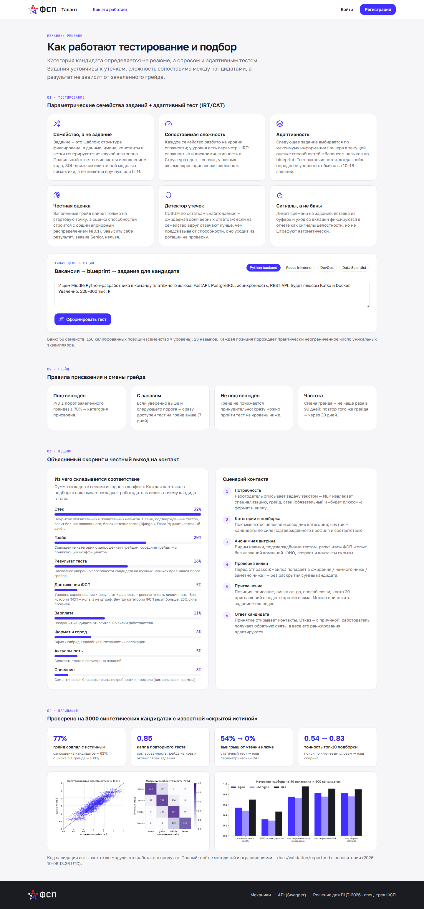

<div align="center">

<picture>
  <source media="(prefers-color-scheme: dark)" srcset="frontend/src/assets/logo-on-dark.svg">
  
</picture>

# ФСП Талант

**Платформа подбора ИТ-специалистов с обратной механикой**<br>
Кандидат подтверждает грейд адаптивным тестом, работодатель сам приходит к нему с предложением и зарплатной вилкой.

ЛЦТ-2026 · специальный трек Федерации спортивного программирования · команда **Ashen One**

[](https://github.com/kireev-duty/VeriCode/actions/workflows/ci.yml)
[](LICENSE)


[🎬 **Видео**](https://cloud.mail.ru/public/2fce/HawvwLkqr) &nbsp;·&nbsp;
[📊 **Презентация**](https://cloud.mail.ru/public/2fce/HawvwLkqr) &nbsp;·&nbsp;
[📄 **Документация (PDF)**](docs/ФСП-Талант-документация.pdf) &nbsp;·&nbsp;
[📈 **Отчёт валидации**](docs/validation/report.md) &nbsp;·&nbsp;
[🚀 **Быстрый старт**](#-быстрый-старт)

</div>

---

## 📑 Содержание

- [Что внутри](#-что-внутри)
- [Ключевые цифры](#-ключевые-цифры)
- [Скриншоты](#-скриншоты)
- [Быстрый старт](#-быстрый-старт)
- [Архитектура](#-архитектура)
- [Документация](#-документация)
- [Структура репозитория](#-структура-репозитория)
- [Тесты](#-тесты)
- [Лицензия](#-лицензия)

## ✨ Что внутри

🧪 **Тест на грейд, устойчивый к утечкам** ([подробнее](docs/02-testing.md))<br>
Задания — параметрические *семейства*: у каждого кандидата свой экземпляр, правильный ответ вычисляется исполнением
кода, SQL-движком или точной моделью семантики. Модель IRT (3PL) и адаптивный отбор заданий (CAT) с балансом
навыков и контролем экспозиции. Детектор утечек на CUSUM.

🎯 **Объяснимый подбор** ([подробнее](docs/03-matching.md))<br>
Работодатель описывает потребность текстом, NLP разбирает его в структуру. Система рекомендует категории и ранжирует
кандидатов; к каждой карточке приложено объяснение вкладов.

🤝 **Честный выход на контакт**

- анонимная витрина до согласия кандидата;
- проверка «вилка попадает в ожидания» без раскрытия суммы;
- квота приглашений;
- отказ с причиной, который адаптирует веса ранжирования компании.

🏅 **ФСП ID и достижения** ([подробнее](docs/04-fsp-integration.md))<br>
Привязка через OIDC (Keycloak, realm `fsp`). Мок реестра ФСП реализует предложенный нами контракт данных.
Кандидат без истории ФСП ничего не теряет.

➕ **Сверх обязательного** ([концепция антифрода и ATS](docs/06-antifraud-ats.md))<br>
отклики на вакансии · регулярные задания с оценкой по рубрике · PDF-профиль с QR-проверкой подлинности ·
траст-скор работодателя · вебхуки для ATS · адаптивная вёрстка.

## 📊 Ключевые цифры

Монте-Карло симуляция на 3000 синтетических кандидатах с известной «скрытой истиной».
Методика и ограничения — в [отчёте валидации](docs/validation/report.md).

| Что проверяли | Результат |
|---|---|
| Грейд совпал с истинным | **77,5%** (самооценка — 63%); ошибка ≤ 1 грейда — 100% |
| Повторный тест на новых экземплярах | κ = **0,85** |
| Утечка ключа к 40% заданий: доля «нечестных» с повышенным грейдом | статичный тест 54% → **наш тест 0%** |
| Точность топ-10 подборки (P@10) | поиск по ключевым словам 0,54 → **наш скоринг 0,82** |
| Детектор утечек | 3,7% ложных срабатываний; 65–80% обнаружения |

<table>
  <tr>
    <td></td>
    <td></td>
  </tr>
</table>

## 🖼 Скриншоты

<table>
  <tr>
    <td align="center"><br><sub>Главная</sub></td>
    <td align="center"><br><sub>Адаптивный тест кандидата</sub></td>
  </tr>
  <tr>
    <td align="center"><br><sub>Кабинет работодателя</sub></td>
    <td align="center"><br><sub>Механики вживую: blueprint и генерация заданий</sub></td>
  </tr>
</table>

## 🚀 Быстрый старт

Нужен Docker с Compose v2 и около 3 ГБ свободной памяти.

```bash
git clone https://github.com/kireev-duty/VeriCode.git && cd VeriCode
docker compose up -d --build
```

Через 1–2 минуты откройте http://localhost:8080. При первом запуске в базу загружаются демо-данные: 500 кандидатов,
15 компаний, вакансии и история приглашений.

| Адрес | Что там |
|---|---|
| http://localhost:8080 | Веб-приложение |
| http://localhost:8080/api/docs | Swagger (OpenAPI) |
| http://localhost:8080/auth | ФСП ID (Keycloak), админка: `admin` / `admin` |
| http://localhost:8080/mail | Тестовый почтовый ящик (письма подтверждения email) |

Развёртывание на сервере с HTTPS (Caddy) — [docs/08-deploy.md](docs/08-deploy.md).

<details>
<summary><b>🔑 Демо-доступ</b></summary>

<br>

Пароль для всех демо-аккаунтов — `demo12345`. На странице входа есть кнопки быстрого входа.

| Аккаунт | Роль |
|---|---|
| `demo.employer@fsp-talent.ru` | Работодатель «Кодовая Гавань»: потребности, подборки, вакансии, задания, история приглашений |
| `demo.candidate@fsp-talent.ru` | Кандидат Middle Backend с ФСП ID, приглашениями и заданием недели |
| `demo.new@fsp-talent.ru` | Новый кандидат: пройти опрос и тест с нуля |

Тестовые участники в ФСП ID: `fsp-100231`, `fsp-123457`, `fsp-200001`, `fsp-300010` (без истории), пароль `fsp12345`.

Все компании и люди в демо-данных вымышлены.

</details>

<details>
<summary><b>🧭 Сквозной сценарий для проверки (5–7 минут)</b></summary>

<br>

1. **Регистрация кандидата.** «Регистрация» → «Я ищу работу» → подтвердите email: ссылка есть в ответе и в `/mail`.
2. **Опрос и тест.** Согласия → специализация → стек → самооценка → грейд, затем адаптивный тест из 10–18 заданий.
   Результат: категория, интервал оценки, профиль по навыкам, разбор заданий.
3. **ФСП ID.** «Настройки» → «Привязать ФСП ID» → вход в Keycloak (`fsp-123457` / `fsp12345`) → достижения загружаются
   из реестра.
4. **Подбор у работодателя.** Войдите как работодатель → «Новая потребность» → опишите задачу текстом →
   «Разобрать текст» → «Найти кандидатов». Дальше:
   - посмотрите рекомендованные категории, объяснения и фильтры;
   - нажмите «Пригласить»: система проверит, попадает ли вилка в ожидания кандидата, после чего можно отправить
     приглашение.
5. **Ответ кандидата.** Войдите как кандидат → «Приглашения» → «Принять»: у работодателя откроются контакты.
   Или отклоните с причиной: веса подбора компании адаптируются (страница «Компания»).
6. **Классический отклик.** «Вакансии» → «Откликнуться» → у работодателя отклик появится с контактами.
7. **Механики вживую.** На странице http://localhost:8080/how вставьте текст вакансии: система покажет blueprint теста и
   сгенерирует задания. Повторная генерация даёт новые экземпляры.

</details>

## 🏗 Архитектура

| Сервис | Технологии | Роль |
|---|---|---|
| `frontend` | React, TypeScript, Vite, Tailwind, nginx | Кабинеты кандидата и работодателя, прокси `/api`, `/auth`, `/mail` |
| `backend` | Python 3.12, FastAPI, SQLAlchemy, Alembic, NumPy | Тестирование (IRT/CAT), подбор, приглашения, PDF-профиль |
| `fsp_registry` | FastAPI | Мок реестра достижений ФСП |
| `keycloak` | Keycloak 26.1 | ФСП ID: OIDC-провайдер, realm `fsp` |
| `db` | PostgreSQL 16 | Основная СУБД |
| `mailpit` | Mailpit 1.21 | SMTP и веб-ящик для писем на стенде |
| `ollama` | Ollama (необязательно) | Локальная LLM; без GPU, система работает и без неё |

Подробно — [docs/01-architecture.md](docs/01-architecture.md), API — [docs/05-api.md](docs/05-api.md),
библиотеки и версии — [docs/07-libraries.md](docs/07-libraries.md).

## 📚 Документация

| Раздел ТЗ 3.4 | Документ |
|---|---|
| Краткое описание подхода | [docs/00-summary.md](docs/00-summary.md) |
| Функциональная и компонентная архитектура | [docs/01-architecture.md](docs/01-architecture.md) |
| Механика тестирования и устойчивость к утечкам | [docs/02-testing.md](docs/02-testing.md) |
| Механика подбора и категоризации | [docs/03-matching.md](docs/03-matching.md) |
| Процедура валидации и результаты | [docs/validation/report.md](docs/validation/report.md) |
| Схема интеграции с реестром ФСП | [docs/04-fsp-integration.md](docs/04-fsp-integration.md) |
| Описание API | [docs/05-api.md](docs/05-api.md) и Swagger `/api/docs` |
| Концепция за рамками MVP: антифрод и ATS | [docs/06-antifraud-ats.md](docs/06-antifraud-ats.md) |
| Библиотеки и версии | [docs/07-libraries.md](docs/07-libraries.md) |
| Сборка, развёртывание, локальный запуск | [docs/08-deploy.md](docs/08-deploy.md) |

Вся документация одним файлом — [docs/ФСП-Талант-документация.pdf](docs/ФСП-Талант-документация.pdf).
Презентация — [ЛЦТ_2026_Ashen One_ФСП.pptx](ЛЦТ_2026_Ashen%20One_ФСП.pptx)
(и в [облаке вместе с видео](https://cloud.mail.ru/public/2fce/HawvwLkqr)).

## 🗂 Структура репозитория

```
backend/            FastAPI, SQLAlchemy, Alembic; модули: assessment (IRT/CAT + семейства заданий),
                    matching, invitations, fsp, resume, trust, tasks; seed (синтетика), validation, tests
frontend/           React + TypeScript + Vite + Tailwind; кабинеты кандидата и работодателя
e2e/                Playwright: сквозной сценарий и скриншоты
deploy/             realm «fsp» для Keycloak, Caddyfile для HTTPS
docs/               документация, отчёт валидации, скриншоты
docker-compose.yml  postgres, backend, fsp_registry, keycloak, mailpit, frontend (nginx)
```

## ✅ Тесты

```bash
cd backend
uv sync
uv run pytest -q                          # юнит- и интеграционные тесты
uv run python -m validation.run --quick   # быстрый прогон валидации

cd ../e2e
npm ci && npx playwright test             # e2e на поднятом стенде
```

Всё это гоняется в [GitHub Actions](https://github.com/kireev-duty/VeriCode/actions/workflows/ci.yml) на каждый push.

## 📄 Лицензия

Исходный код — [MIT](LICENSE). Шрифты PT Sans, Golos Text и JetBrains Mono распространяются по OFL. Логотипы ФСП взяты
из брендбука, предоставленного организаторами для хакатона.
