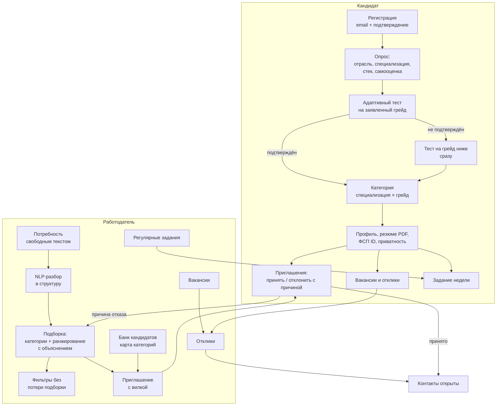
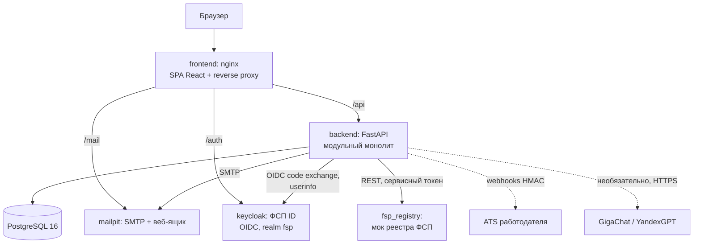
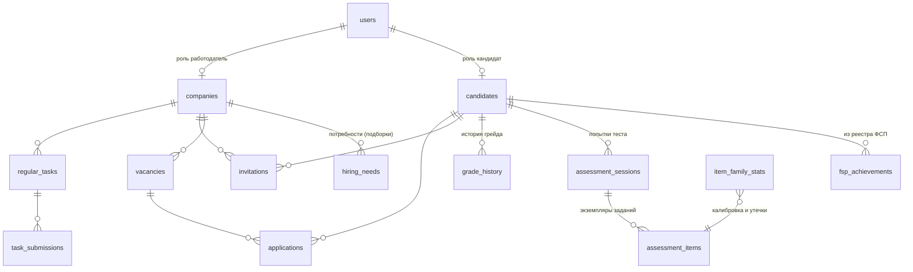

# 1. Архитектура решения

## Функциональная архитектура

Роли и права:

| Роль | Видит | Не видит |
|---|---|---|
| Кандидат | свой профиль, свои приглашения, отклики и задания, опубликованные вакансии | данные других кандидатов |
| Работодатель | обезличенные карточки кандидатов с грейдом, навыками, ФСП; свои потребности, приглашения, вакансии и отклики | ФИО, контакты, возраст и фото кандидата — до принятия приглашения или отклика; точную сумму ожиданий |
| Гость | лендинг, механики, публичную проверку PDF-профиля по QR | кабинеты |

## Компонентная архитектура

Backend — **модульный монолит** с явными границами модулей. Это осознанный выбор для MVP: один процесс проще
развернуть и отладить, а модули слабо связаны и выносятся в сервисы без переписывания. Реестр ФСП уже работает
отдельным сервисом: интеграция проверена по сети, а не вызовом функции.

| Модуль (`backend/app/modules`) | Ответственность |
|---|---|
| `assessment/families` | 59 параметрических семейств заданий (150 позиций «семейство × уровень»), генераторы с вычисляемыми ответами |
| `assessment/irt.py`, `cat.py` | 3PL IRT, EAP-оценка, адаптивный отбор, правило остановки, решение о грейде. Чистые функции без БД |
| `assessment/service.py` | Политика смены грейда, сессии, приём ответов, детектор утечек (CUSUM), калибровочные счётчики |
| `matching/scoring.py` | Объяснимый скоринг «кандидат ↔ потребность», сила профиля внутри категории, адаптация весов |
| `matching/service.py` | Подборки, категории, фильтры, анонимные карточки, правило раскрытия контактов |
| `nlp.py` | Извлечение навыков, грейда, специализации, вилки, формата и города из текста; символьная близость текстов |
| `llm.py` | Необязательный слой GigaChat / YandexGPT поверх правил: уточнение разбора с проверкой по справочнику, фолбэк на правила |
| `invitations.py` | Жизненный цикл приглашений и откликов, квота, причины отказов, вебхуки |
| `fsp/` | ФСП ID (OIDC), клиент реестра, мок реестра, скоринг достижений |
| `resume.py`, `pdf_profile.py` | Разбор PDF-резюме; стандартизированный PDF-профиль с QR |
| `trust.py` | Траст-скор работодателя (защита от фиктивных вакансий) |
| `tasks.py` | Регулярные задания, оценка по рубрике, индекс актуальности |
| `events.py` | Уведомления в приложении и исходящие вебхуки |

Слои: `api/` (HTTP, схемы Pydantic, права) → `modules/` (бизнес-логика) → `models/` (SQLAlchemy) → PostgreSQL.
Скоринг и движок теста — чистые функции: продукт и офлайн-валидация (`backend/validation`) выполняют **один и тот же
код**.

## Модель данных (основное)

## Безопасность и 152-ФЗ

- **Пароли:** argon2id. **Токены:** JWT HS256 с ограниченным сроком. Одноразовые токены подтверждения email хранятся
  только в виде SHA-256.
- **Разграничение прав по ролям** на уровне зависимостей FastAPI (`current_candidate` / `current_company`).
  Доступ к чужим объектам возвращает 404, чтобы не раскрывать само существование объекта.
- **Согласия:** два отдельных согласия — на обработку и на публикацию обезличенного профиля, с датами. Без согласия на
  публикацию кандидат не попадает в выдачу.
- **Право на удаление:** удаление аккаунта каскадно стирает все персональные данные.
- **Минимизация данных:**
  - работодатель не получает ФИО и контакты до согласия кандидата;
  - точная сумма ожиданий не раскрывается никогда, работодатель видит только «попадает / не попадает»;
  - названия прошлых работодателей скрыты по умолчанию.
- **Языковая модель и ПДн:** модель необязательна (по умолчанию `LLM_PROVIDER=none`), все сценарии работают на
  правилах. При разборе резюме email, телефон и Telegram вырезаются из текста до отправки модели
  (`nlp.redact_contacts`), контакты извлекаются только правилами на сервере. ФИО модель получает, но правило
  остаётся приоритетным. GigaChat и YandexGPT обрабатывают данные в РФ, трансграничной передачи нет. Режим с локальной
  открытой моделью Qwen3-4B (профиль `local-llm`) оставляет резюме полностью на сервере.
- **ФСП ID:** подписанный параметр `state` против CSRF, обмен кода на сервере, `client_secret` не покидает backend.
- **Вебхуки:** подпись HMAC-SHA256.

## Производительность

Подборка строится в памяти по кандидатам целевой и соседних категорий (сотни записей), формирование занимает
десятки миллисекунд. Выбор следующего задания — O(размер банка). Для масштаба в десятки тысяч кандидатов в категории
путь развития такой:
- предварительный отбор в БД (индексы по `specialization`, `grade`, GIN-индекс по навыкам);
- кэш карточек;
- вынос скоринга в отдельный воркер.
