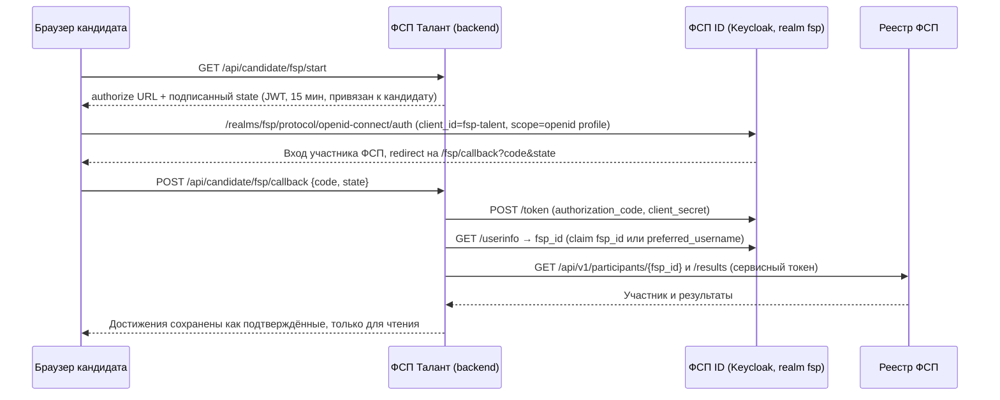

# 4. Схема интеграции с реестром ФСП

API и структура данных ФСП на хакатоне не предоставлялись. Ниже — **наше предложение** контракта, которое реализовано
и работает в демо: Keycloak как ФСП ID и отдельный сервис-мок реестра.

## Поток привязки ФСП ID



Свойства потока:
- `client_secret` хранится только на backend. Параметр `state` защищает от CSRF и от подмены кандидата.
- Один ФСП ID нельзя привязать к двум профилям (409).
- Кандидат может обновить данные («Обновить») или отвязать ФСП ID.
- **Если истории нет:** участник существует, но результатов нет, — профиль остаётся полноценным, вклад ФСП равен
  нулю (не штрафу). Работодатель видит нейтральную метку «нет данных ФСП».
- **Если участник не найден:** возвращается 404 с понятным сообщением.
- **Режим без Keycloak** (`FSP_OIDC_ENABLED=false`): встроенная страница-заглушка ФСП ID с тем же потоком
  `code` / `state`.

Для совместимости с будущим ФСП ID на Keycloak достаточно настроить три параметра: `FSP_OIDC_ISSUER`,
`FSP_OIDC_CLIENT_ID` и `FSP_OIDC_CLIENT_SECRET`. Сервер реестра — `FSP_REGISTRY_URL`.

## Предлагаемый контракт реестра

`GET /api/v1/participants/{fsp_id}`, авторизация сервис-сервис (в проде — client credentials в Keycloak):

```json
{
  "fsp_id": "FSP-123457",
  "full_name": "Мария Иванова",
  "birth_year": 2001,
  "region": "Краснодарского края",
  "rank": "МС",
  "rating": 1903,
  "disciplines": ["product", "security"]
}
```

`GET /api/v1/participants/{fsp_id}/results`:

```json
[{
  "id": "FSP-123457-R1",
  "event": {"id": "EV-3f2a1c", "name": "Всероссийский хакатон ФСП «Цифровой прорыв»",
            "level": "federal", "discipline": "product", "date": "2024-09-19", "city": "Казань"},
  "place": 3, "participants_count": 246, "result_type": "prize",
  "team": {"name": "Null Pointer", "role": "Аналитик", "size": 4},
  "certificate_url": "https://fsp-russia.com/certificates/FSP-123457-R1.pdf"
}]
```

Справочники:

| Поле | Значения |
|---|---|
| `level` | `regional`, `federal`, `international` |
| `discipline` | `product`, `algorithmic`, `security`, `drones`, `robotics` — пять дисциплин спортивного программирования |
| `result_type` | `winner`, `prize`, `finalist`, `participant` |
| `rank` | спортивный разряд: `""`, `III`, `II`, `I`, `КМС`, `МС`, `МСМК` |

## Что и как показываем работодателю

- Бейдж «ФСП · разряд КМС» в карточке, список результатов: событие, уровень, дисциплина, место из N, роль в команде,
  год. Пометка «подтверждено реестром».
- Роль «Капитан» в команде автоматически добавляет кандидату роль «Капитан команды».
- Дисциплина отображается на навыки: алгоритмическое → алгоритмы; ИБ → security, Linux, HTTP; продуктовое →
  проектирование, REST, git.

**Сигнал ФСП** (`fsp/scoring.py`) — насыщающаяся сумма 1 − exp(−T), где

T = 0,7 · Σ_призовые wᵢ + min(0,3; 0,7 · Σ_участия wᵢ) + вес разряда,
wᵢ = результат (победитель 1 / призёр 0,75 / финалист 0,45 / участник 0,2) × давность (полураспад 2 года).

Разряд даёт от 0,1 (III) до 1,0 (МСМК).

Принципы (по ответам постановщиков):
- **Нет иерархии соревнований и дисциплин.** Региональный хакатон и всероссийский чемпионат, продуктовое и
  алгоритмическое программирование весят одинаково. Уровень и дисциплина показываются работодателю, но в
  скоринг не входят.
- **Важны число соревнований и результат.** Победитель и призёр весят заметно больше, чем участник.
- **Профиль нельзя набить онлайн-явками.** Суммарный вклад участий без места ограничен потолком 0,3. Это меньше
  одного призового места (0,7 · 0,75 ≈ 0,53).
- **Вклад в командный результат не делим.** FSP ID не фиксирует, кто что сделал в команде, поэтому командное
  место засчитывается каждому участнику одинаково.
- **Свежий результат весит больше** (полураспад 2 года). На старте платформы архива почти нет, поэтому
  эффект небольшой.

Сигнал используется:
- **в силе профиля внутри категории** — вес 0,25: выше те, у кого есть подтверждённые достижения (ТЗ);
- **в соответствии потребности** — вес 0,05: валидация показала, что для вопроса «подходит ли кандидат» тест уже
  измеряет ту же способность;
- в фильтре «только с достижениями ФСП» и в требовании потребности `require_fsp`.

Кандидат может скрыть достижения от работодателей в настройках приватности.

## Что предлагаем ФСП для реальной интеграции

1. Claim `fsp_id` в токене ФСП ID (mapper атрибута пользователя). Тогда не нужно полагаться на `preferred_username`.
2. Эндпоинты реестра, как выше, с пагинацией и `updated_since` для инкрементальной синхронизации.
3. Webhook `participant.result.created`, чтобы достижения появлялись в профиле без ручного «Обновить».
4. Ссылки на верифицируемые сертификаты (подпись или QR), которые мы показываем работодателю.
5. Согласие участника на передачу результатов платформе как OAuth-scope `fsp.results.read`.
