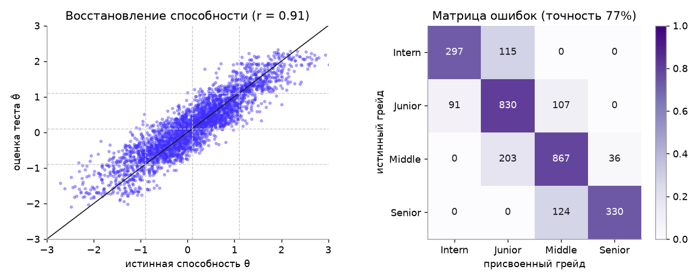
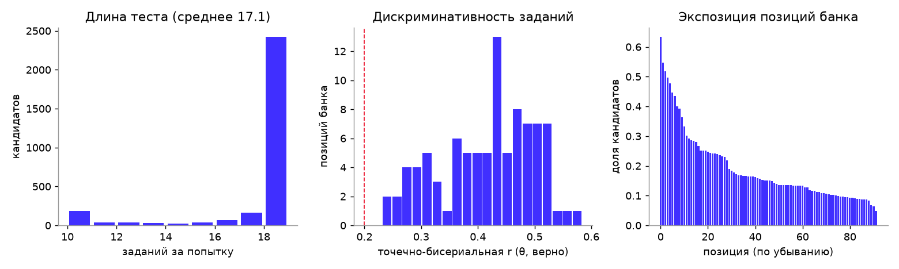
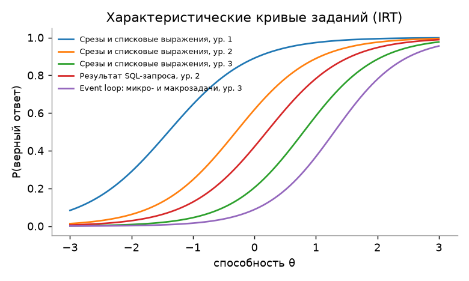
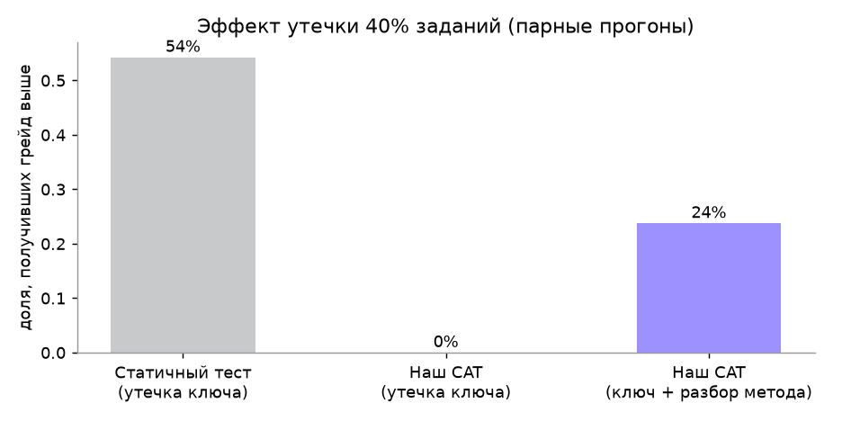
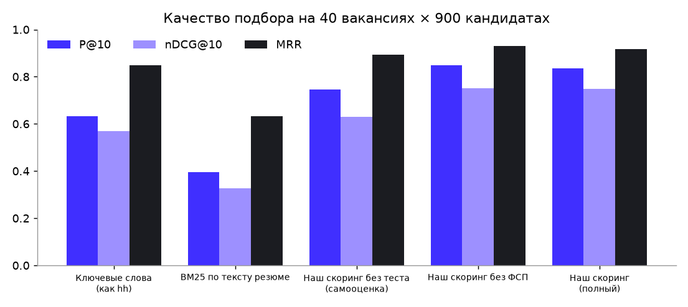

# Валидация решения

Отчёт сгенерирован командой `uv run python -m validation.run` (2026-10-05 09:02 UTC).
Код валидации — `backend/validation/run.py`; он вызывает **те же модули**, что работают в продукте
(`cat.py`, `scoring.py`, `nlp.py`), на синтетической популяции с известной «скрытой истиной» (`app/seed/synth.py`).

## Почему синтетика и как она устроена

Эталонной разметки на хакатоне нет, поэтому мы моделируем кандидатов, у которых **истинная способность известна**:
- у каждого кандидата есть истинная способность θ ~ N(0,15; 0,95) и способности по навыкам θ_s = θ + N(0; 0,45);
- наблюдаемое — заявленный грейд (шумная и слегка завышенная самооценка), стек, опыт, ожидания по зарплате — порождается из θ с шумом;
- ответы на задания генерируются по модели 3PL с **«истинными» параметрами заданий, отличающимися от экспертных** (b ± 0,25, a × e^N(0; 0,15)), — движок теста их не знает, как и в реальности до калибровки.

Так мы проверяем то, что важно жюри: восстанавливает ли система скрытую правду, а не совпадает ли сама с собой.

## 1. Точность присвоения грейда

3000 кандидатов прошли полный сценарий (тест на заявленный грейд → при неуспехе сразу тест на грейд ниже).

| Метрика | Значение |
|---|---|
| Грейд совпал с истинным | **77.5%** |
| Ошибка не больше одного грейда | **100.0%** |
| Завышение / занижение | 8.6% / 13.9% |
| Для сравнения: самооценка кандидата совпадает с истиной | 63.4% (завышают 24.0%) |
| Корреляция оценки θ̂ с истинной θ | 0.907 (RMSE 0.401) |
| Заданий за попытку (среднее) | 17.1 |
| Попыток до присвоения (среднее) | 1.6 |

**Нейтральность к заявленному грейду.** Тех же кандидатов прогнали дважды: с честным заявленным грейдом и с завышенным
на ступень. Средний сдвиг оценки θ̂ — **-0.045 ± 0.053** (95% ДИ), то есть статистически
неотличим от нуля; разброс разницы (SD 0.545) такой же, как между двумя честными попытками
(SD 0.476). Заявленный грейд влияет только на выбор стартовых заданий, а оценка строится с общим
априорным распределением N(0,1): «заявить Senior на удачу» бесполезно.

**Точность решения «подтвердить / не подтвердить».** Первая попытка подтверждает заявленный грейд тогда и только тогда,
когда истинная способность не ниже порога, в **82.9%** случаев.

**Как выбирались параметры.** Порог подтверждения P(θ ≥ порог) перебирался на той же симуляции: 0,7 даёт 73% точного
совпадения при 21% занижений, 0,6 — ~78% при 16%, 0,5 — ~79%, но завышений становится больше. Выбрано 0,6: работодателю
важнее, чтобы подтверждённый грейд не был завышен. Проверена и альтернатива «повторная попытка продолжает измерение»
(ответы первой попытки учитываются): на 22% меньше заданий, но точность на 5 п. п. ниже, поэтому попытки независимы.

## 2. Согласованность (test-retest)

Каждый кандидат прошёл тест повторно с новыми случайными экземплярами заданий.

| Метрика | Значение |
|---|---|
| Тот же грейд при повторе | **76.7%** |
| Взвешенная каппа Коэна | **0.846** |
| Корреляция θ̂ между попытками | 0.866 |

Квадратично-взвешенная каппа выше 0,8 считается «почти полным согласием».

## 3. Дискриминативность заданий

| Метрика | Значение |
|---|---|
| Медианная точечно-бисериальная корреляция «способность — верный ответ» | **0.429** |
| Доля позиций банка с r ≥ 0,2 (порог пригодности задания) | 100.0% |
| Использовано позиций банка | 92 из 92 |
| Максимальная экспозиция позиции | 63.4% кандидатов |

## 4. Устойчивость к утечке заданий

Моделируем утечку 40% заданий. Дизайн **парный**: каждый кандидат проходит тест дважды на одних и тех же случайных
числах — честно и со «слитыми» знаниями. Поэтому разница показывает эффект утечки, а не шум повторного теста.

| Сценарий | Средний прирост θ̂ | Доля получивших грейд выше |
|---|---|---|
| Статичный тест (одна форма), утёк ключ ответов | +0.56 | **54.2%** |
| Наш CAT, утёк ключ ответов | +0.00 | **0.0%** |
| Наш CAT, утёк ключ и разбор метода (+0,15 к вероятности на «слитых» семействах) | +0.24 | 23.7% |

В параметрическом тесте слитый ключ бесполезен: новый кандидат получает другие данные и другой правильный ответ.
Остаётся «утечка метода» — кандидат заранее разобрался, как решаются такие задачи. Её эффект ограничен, и по сути это
освоение навыка.

**Детектор утечек** (`assessment/leak.py`) — односторонний CUSUM остатков «наблюдаемая − ожидаемая доля верных»
относительно собственной базовой линии позиции. Базовая линия нужна, потому что экспертные параметры заданий неточны:
без неё любая неоткалиброванная позиция выглядела бы «слитой». Первая версия детектора без базовой линии давала 47%
ложных срабатываний; эта проверка её и выявила.

| Метрика | Значение |
|---|---|
| Ложные срабатывания на честном потоке (600 ответов) | 3.7% |
| Обнаружение, ответ знают 30% отвечающих (за 400 ответов) | 64.7%, медианная задержка 40 ответов |
| Обнаружение, ответ знают 50% отвечающих | 79.7%, медианная задержка 21 ответов |

Детектор — вторая линия защиты. Первая — параметризация, при которой ключ ответов вообще не переносится.

## 5. Уникальность экземпляров

Для каждой позиции банка (92) сгенерировано 400 экземпляров; вероятность, что два кандидата получат
**идентичный** экземпляр, — Σp².

| Метрика | Значение |
|---|---|
| Медианная вероятность совпадения | **0.0025** |
| Доля позиций с вероятностью совпадения < 1% | 78.3% |
| Медианная доля самого частого правильного ответа | 18.8% |

Наименее вариативные позиции (кандидаты на расширение шаблонов):

| Позиция | Различных экземпляров из 400 | P(совпадения) |
|---|---|---|
| `cron_schedule:1` | 20 | 0.052 |
| `linux_perms:2` | 24 | 0.045 |
| `py_classes:3` | 24 | 0.044 |
| `stats_basic:2` | 25 | 0.042 |
| `stats_basic:3` | 36 | 0.031 |

## 6. Качество подбора

40 вакансий × 900 кандидатов. Релевантность пары (0–3) вычисляется из **скрытой истины**:
истинный грейд, реальное владение обязательными навыками на уровне вакансии (заявлено в профиле и истинная θ_s выше порога),
совместимость по зарплате и формату. Ни одна система не видит эти величины напрямую. Результаты соревнований ФСП
моделируются как шумное измерение способности (результат = θ + N(0; 0,8) → победитель / призёр / финалист / участник,
разряд аналогично), участие в ФСП слабо коррелирует со способностью. Медиана «хороших» (rel ≥ 2)
кандидатов на вакансию — 51. Все системы ранжируют кандидатов одной специализации.

| Система | P@10 | nDCG@10 | MRR |
|---|---|---|---|
| Ключевые слова (как hh) | 0.632 | 0.569 | 0.848 |
| BM25 по тексту резюме | 0.395 | 0.327 | 0.632 |
| Наш скоринг без теста (самооценка) | 0.745 | 0.630 | 0.893 |
| Наш скоринг без ФСП | 0.848 | 0.750 | 0.931 |
| Наш скоринг (полный) | 0.835 | 0.748 | 0.917 |

Ключевое: самоописанные данные (ключевые слова, самооценка) ранжируют хуже, чем подтверждённый тестом профиль.
Абляция «без теста» показывает вклад механики тестирования в подбор.

**Роль ФСП.** Для вопроса «подходит ли кандидат вакансии» бонус ФСП почти ничего не добавляет к тесту: тест уже
измеряет ту же способность, а кандидат чуть выше порога так же «подходит», как сильный. Поэтому вес ФСП в соответствии
вакансии подобран небольшим (0,05; перебор весов 0 / 0,03 / 0,05 / 0,1 — в коде валидации). ТЗ отводит ФСП другую
роль — **ранжирование внутри категории** по силе подтверждённого профиля. Здесь ФСП — независимое второе измерение,
и оно помогает: корреляция Спирмена порядка внутри категории с истинной способностью (20 категорий):

| Порядок внутри категории | ρ Спирмена с истинной θ |
|---|---|
| Сила профиля: тест + ФСП + актуальность | **0.577** |
| Без ФСП (тест + актуальность) | 0.55 |
| Только ФСП | 0.226 |

## 7. Разбор текста потребности

68 описаний (8 написаны вручную в разных стилях, остальные — шаблонные вакансии с эталоном).

| Метрика | Значение |
|---|---|
| Навыки: точность / полнота / F1 | 0.997 / 1.0 / **0.998** |
| F1 по навыкам на ручных текстах | 0.986 |
| Специализация | 100.0% |
| Грейд (где указан) | 100.0% |
| Вилка | 100.0% |
| Формат работы | 100.0% |

## Ограничения и что дальше

- Синтетика проверяет корректность механики, но не реальные параметры заданий. После хакатона: пилот на 50–100
  участниках ФСП, калибровка a и b по реальным ответам (маргинальная оценка максимального правдоподобия), сравнение
  грейда с экспертной оценкой тимлидов (корреляция Спирмена).
- Пилот на людях и экспертная разметка ~100 пар «вакансия — кандидат» дополняют этот отчёт (раздел будет добавлен
  по результатам).
