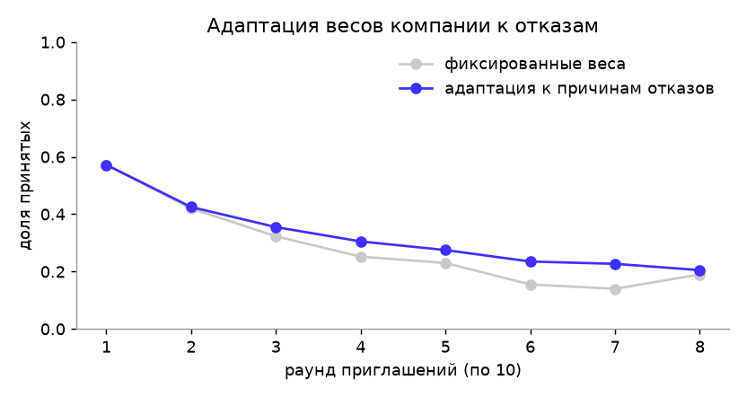

# Валидация решения

Отчёт сгенерирован командой `uv run python -m validation.run` (2026-10-08 08:27 UTC).
Код валидации — `backend/validation/run.py`; он вызывает **те же модули**, что работают в продукте
(`cat.py`, `scoring.py`, `nlp.py`), на синтетической популяции с известной «скрытой истиной» (`app/seed/synth.py`).

## Почему синтетика и как она устроена

Эталонной разметки на хакатоне нет, поэтому мы моделируем кандидатов, у которых **истинная способность известна**:
- у каждого кандидата есть истинная способность θ ~ N(0,15; 0,95) и способности по навыкам θ_s = θ + N(0; 0,45);
- наблюдаемое — заявленный грейд (шумная и слегка завышенная самооценка), стек, опыт, ожидания по зарплате — порождается из θ с шумом;
- ответы на задания генерируются по модели 3PL с **«истинными» параметрами заданий, отличающимися от экспертных** (b ± 0,25, a × e^N(0; 0,15)), — движок теста их не знает, как и в реальности до калибровки.

Так мы проверяем то, что важно жюри: восстанавливает ли система скрытую правду, а не совпадает ли сама с собой.

## 1. Точность присвоения грейда

3000 кандидатов прошли полный сценарий (тест на заявленный грейд → при неуспехе сразу тест на грейд ниже).

| Метрика | Значение |
|---|---|
| Грейд совпал с истинным | **76.7%** |
| Ошибка не больше одного грейда | **100.0%** |
| Завышение / занижение | 8.8% / 14.5% |
| Для сравнения: самооценка кандидата совпадает с истиной | 63.4% (завышают 24.0%) |
| Корреляция оценки θ̂ с истинной θ | 0.908 (RMSE 0.398) |
| Заданий за попытку (среднее) | 16.7 |
| Попыток до присвоения (среднее) | 1.61 |

**Нейтральность к заявленному грейду.** Тех же кандидатов прогнали дважды: с честным заявленным грейдом и с завышенным
на ступень. Средний сдвиг оценки θ̂ — **-0.049 ± 0.05** (95% ДИ), то есть статистически
неотличим от нуля; разброс разницы (SD 0.515) такой же, как между двумя честными попытками
(SD 0.446). Заявленный грейд влияет только на выбор стартовых заданий, а оценка строится с общим
априорным распределением N(0,1): «заявить Senior на удачу» бесполезно.

**Точность решения «подтвердить / не подтвердить».** Первая попытка подтверждает заявленный грейд тогда и только тогда,
когда истинная способность не ниже порога, в **83.0%** случаев.

**Устойчивость к выборке.** Те же метрики на 5 независимых популяциях по 1500 человек
(сиды 11, 12, 13, 14, 15):

| Метрика | Среднее ± SD | По популяциям |
|---|---|---|
| Грейд совпал с истинным | 77.9% ± 0.6 п. п. | 76.9%, 77.8%, 78.5%, 77.9%, 78.4% |
| Ошибка не больше одного грейда | 100.0% ± 0.0 п. п. | 100.0%, 100.0%, 100.0%, 100.0%, 100.0% |
| Взвешенная каппа test-retest | 0.842 ± 0.01 | 0.839, 0.849, 0.849, 0.827, 0.848 |

**Как выбран порог подтверждения.** Порог P(θ ≥ порога грейда) перебирается на отдельной популяции
(1200 человек, сид 13):

| Порог | Грейд совпал | Завышение | Занижение |
|---|---|---|---|
| 0.5 | 76.9% | 12.0% | 11.1% |
| 0.6 | 78.2% | 7.7% | 14.1% |
| 0.7 | 75.7% | 5.6% | 18.7% |

Выбрано 0.6: работодателю важнее, чтобы подтверждённый грейд не был завышен, а более высокий порог
заметно увеличивает занижения. Альтернатива «повторная попытка продолжает измерение» (ответы первой попытки
учитываются) экономит около 20% заданий, но снижает точность, поэтому попытки независимы (`synth.CARRY_OVER`).

## 2. Согласованность (test-retest)

Каждый кандидат прошёл тест повторно с новыми случайными экземплярами заданий.

| Метрика | Значение |
|---|---|
| Тот же грейд при повторе | **77.8%** |
| Взвешенная каппа Коэна | **0.854** |
| Корреляция θ̂ между попытками | 0.874 |

Квадратично-взвешенная каппа выше 0,8 считается «почти полным согласием».

## 3. Дискриминативность заданий и экспозиция

| Метрика | Значение |
|---|---|
| Медианная точечно-бисериальная корреляция «способность — верный ответ» | **0.423** |
| Доля позиций банка с r ≥ 0,2 (порог пригодности задания) | 97.3% |
| Использовано позиций банка | 150 из 150 |

**Экспозиция.** Утечка распространяется среди кандидатов одной специализации, поэтому главная метрика —
доля кандидатов специализации, увидевших позицию (по всем их попыткам). Движок ограничивает её онлайн-вариантом
Sympson–Hetter: позиция, показанная в доле r > 0.4 сессий своей специализации, допускается с
вероятностью 0.4/r, а randomesque сужается с топ-5 до топ-2 по мере уточнения оценки.

| Метрика | Значение |
|---|---|
| Максимальная экспозиция позиции среди всех кандидатов | 43.5% |
| Максимальная экспозиция внутри специализации | 80.0% |
| Максимум «экспозиция позиции × P(совпадения экземпляра)» | 0.68% |

Перебор порога r_max (1200 человек, сид 13):

| r_max | Грейд совпал | Заданий за попытку | Max экспозиция (все) | Max экспозиция (в специализации) |
|---|---|---|---|---|
| выключено | 78.0% | 16.5 | 47.2% | 94.4% |
| 0.6 | 79.2% | 16.6 | 47.3% | 84.9% |
| 0.5 | 77.7% | 16.6 | 44.3% | 83.2% |
| 0.4 | 78.2% | 16.6 | 44.0% | 80.7% |
| 0.3 | 77.2% | 16.9 | 40.6% | 83.2% |

Ниже 80.7% внутри специализации экспозицию не опустить без потери
содержательной валидности: квота навыка задаёт минимум. Например, QA-тесту нужно около 6 заданий по тест-дизайну
из 10 позиций этого навыка. Поэтому экспозиция *позиции* — не экспозиция *содержания*: каждая сессия получает свой
экземпляр семейства, и вероятность, что кандидат увидит тот же экземпляр, что и его знакомый, ограничена
произведением в последней строке таблицы выше. Банк расширен до 150 позиций, в том числе
чтобы у самых нагруженных навыков (тест-дизайн, ML, статистика, Docker, JavaScript) появился выбор.

## 4. Устойчивость к утечке заданий

Моделируем утечку 40% заданий. Дизайн **парный**: каждый кандидат проходит тест дважды на одних и тех же случайных
числах — честно и со «слитыми» знаниями. Поэтому разница показывает эффект утечки, а не шум повторного теста.

| Сценарий | Средний прирост θ̂ | Доля получивших грейд выше |
|---|---|---|
| Статичный тест (одна форма), утёк ключ ответов | +0.53 | **53.5%** |
| Наш CAT, утёк ключ ответов | +0.00 | **0.0%** |
| Наш CAT, утёк ключ и разбор метода (+0,15 к вероятности на «слитых» семействах) | +0.18 | 15.9% |

В параметрическом тесте слитый ключ бесполезен: новый кандидат получает другие данные и другой правильный ответ.
Остаётся «утечка метода» — кандидат заранее разобрался, как решаются такие задачи. Её эффект ограничен, и по сути это
освоение навыка.

**Детектор утечек** (`assessment/leak.py`) — односторонний CUSUM остатков «наблюдаемая − ожидаемая доля верных»
относительно собственной базовой линии позиции. Базовая линия нужна, потому что экспертные параметры заданий неточны:
без неё любая неоткалиброванная позиция выглядела бы «слитой». Первая версия детектора без базовой линии давала 47%
ложных срабатываний; эта проверка её и выявила.

| Метрика | Значение |
|---|---|
| Ложные срабатывания на честном потоке (600 ответов) | 5.3% |
| Обнаружение, ответ знают 30% отвечающих (за 400 ответов) | 59.3%, медианная задержка 35 ответов |
| Обнаружение, ответ знают 50% отвечающих | 80.3%, медианная задержка 21 ответов |

Детектор — вторая линия защиты. Первая — параметризация, при которой ключ ответов вообще не переносится.

## 5. Уникальность экземпляров

Для каждой позиции банка (150) сгенерировано 400 экземпляров; вероятность, что два кандидата получат
**идентичный** экземпляр, — Σp².

| Метрика | Значение |
|---|---|
| Медианная вероятность совпадения | **0.0025** |
| Доля позиций с вероятностью совпадения < 1% | 100.0% |
| Медианная доля самого частого правильного ответа | 17.9% |

Наименее вариативные позиции:

| Позиция | Различных экземпляров из 400 | P(совпадения) |
|---|---|---|
| `js_closures:2` | 124 | 0.010 |
| `cron_schedule:1` | 136 | 0.009 |
| `py_classes:3` | 153 | 0.009 |
| `py_iterators:2` | 161 | 0.009 |
| `dom_events:2` | 209 | 0.009 |

## 6. Качество подбора

40 вакансий × 900 кандидатов. Релевантность пары (0–3) вычисляется из **скрытой истины**:
истинный грейд, реальное владение обязательными навыками на уровне вакансии (заявлено в профиле и истинная θ_s выше порога),
совместимость по зарплате и формату. Ни одна система не видит эти величины напрямую. Результаты соревнований ФСП
моделируются как шумное измерение способности (результат = θ + N(0; 0,8) → победитель / призёр / финалист / участник,
разряд аналогично), участие в ФСП слабо коррелирует со способностью. Медиана «хороших» (rel ≥ 2)
кандидатов на вакансию — 41. Все системы ранжируют кандидатов одной специализации.

| Система | P@10 (95% ДИ) | nDCG@10 (95% ДИ) | MRR |
|---|---|---|---|
| Ключевые слова (как hh) | 0.543 (0.463–0.622) | 0.486 (0.433–0.540) | 0.700 |
| BM25 по тексту резюме | 0.322 (0.253–0.398) | 0.296 (0.245–0.350) | 0.468 |
| Наш скоринг без теста (самооценка) | 0.762 (0.690–0.830) | 0.735 (0.687–0.781) | 0.958 |
| Наш скоринг без ФСП | 0.830 (0.753–0.898) | 0.759 (0.711–0.806) | 0.915 |
| Наш скоринг (полный) | 0.818 (0.735–0.890) | 0.761 (0.709–0.812) | 0.901 |

ДИ — перцентильный бутстрап по вакансиям (2000 повторов). Парные разницы считаются по одним и тем же вакансиям,
поэтому общая «сложность» вакансии сокращается:

| Сравнение | Δ P@10 | Δ nDCG@10 |
|---|---|---|
| Полный − Наш скоринг без ФСП | -0.013 (95% ДИ -0.035…+0.005, в пределах шума) | +0.002 (95% ДИ -0.013…+0.015, в пределах шума) |
| Полный − Ключевые слова (как hh) | +0.275 (95% ДИ +0.202…+0.352, значимо) | +0.275 (95% ДИ +0.204…+0.347, значимо) |
| Полный − Наш скоринг без теста (самооценка) | +0.055 (95% ДИ +0.010…+0.100, значимо) | +0.027 (95% ДИ -0.013…+0.066, в пределах шума) |

Ключевое: самоописанные данные (ключевые слова, самооценка) ранжируют хуже, чем подтверждённый тестом профиль.
Абляция «без теста» показывает вклад механики тестирования в подбор.

**Роль ФСП.** Для вопроса «подходит ли кандидат вакансии» бонус ФСП почти ничего не добавляет к тесту: тест уже
измеряет ту же способность, а кандидат чуть выше порога так же «подходит», как сильный. Разница «полный − без ФСП»
выше лежит в пределах шума — в обе стороны. Перебор веса ФСП в оценке соответствия:

| Вес ФСП | P@10 | nDCG@10 |
|---|---|---|
| 0.0 | 0.830 | 0.759 |
| 0.03 | 0.818 | 0.762 |
| 0.05 | 0.818 | 0.761 |
| 0.1 | 0.787 | 0.742 |

Вес оставлен небольшим (0.05): он не ухудшает подбор и даёт работодателю видимый сигнал. ТЗ отводит
ФСП другую роль — **ранжирование внутри категории** по силе подтверждённого профиля. Здесь ФСП — независимое второе
измерение, и оно помогает. Корреляция Спирмена порядка внутри категории с истинной способностью
(20 категорий, ДИ — бутстрап по категориям):

| Порядок внутри категории | ρ Спирмена с истинной θ (95% ДИ) |
|---|---|
| Сила профиля: тест + ФСП + актуальность | **0.563** (0.522–0.602) |
| Без ФСП (тест + актуальность) | 0.54 (0.499–0.580) |
| Только ФСП | 0.188 (0.122–0.257) |

Парная разница «с ФСП − без ФСП» внутри категории: +0.023 (95% ДИ +0.005…+0.044, значимо).

**Чувствительность к определению релевантности.** Пороги синтетической релевантности условны, поэтому метрики
пересчитаны при строгом (без запаса по навыкам, грейд строго равен, зарплата не выше вилки) и мягком (достаточно
половины обязательных навыков, зарплата до +20%) определениях. nDCG@10:

| Система | Базовое | Строгое | Мягкое |
|---|---|---|---|
| Ключевые слова (как hh) | 0.486 | 0.354 | 0.508 |
| BM25 по тексту резюме | 0.296 | 0.228 | 0.306 |
| Наш скоринг без теста (самооценка) | 0.735 | 0.560 | 0.737 |
| Наш скоринг без ФСП | 0.759 | 0.670 | 0.762 |
| Наш скоринг (полный) | 0.761 | 0.666 | 0.765 |

Выводы сохраняются при всех определениях: наш скоринг выше поиска по ключевым словам и BM25, а профиль, подтверждённый тестом, ранжирует лучше самооценки. Полный скоринг и «без ФСП» почти равны и могут меняться местами.

**Адаптация весов к отказам.** Каждая из 40 вакансий — компания, которая 8 раундов подряд
приглашает по 10 лучших ещё не приглашённых кандидатов. У кандидатов скрытое правило: отказ, если вилка
ниже ожиданий, не подходит формат, знакомо меньше 2/3 обязательного стека или позиция ниже их истинного уровня;
иначе согласие с вероятностью 0,8. Отказ с причиной поднимает вес соответствующего компонента
(`scoring.adapt_weights`, шаг +10%, потолок ×2). Контроль — те же компании с фиксированными весами и теми же случайными
числами.

| | Доля принятых за все раунды | Раунды 5–8 |
|---|---|---|
| Фиксированные веса | 28.5% | 17.9% |
| Адаптация к отказам | 32.5% | 23.5% |
| Разница | +0.040 (95% ДИ +0.029…+0.051, значимо) | +0.057 (95% ДИ +0.037…+0.077, значимо) |

## 7. Разбор текста потребности

Три набора описаний вакансий:

- **шаблоны** — 68 текстов: 8 ручных и вакансии генератора
  синтетики. Навыки там названы так же, как в справочнике, поэтому метрики близки к 1 и мало что доказывают;
- **разработка** — 40 реалистичных текстов (`validation/data/needs.json`): «вода»,
  опечатки, английский и смешанный язык, жаргон и транслитерация («постгрес», «кубер», «джангу»), вилки в разных
  форматах. По ним мы находили ошибки правил и дорабатывали их. До доработки на этом наборе было F1 по навыкам 0,865,
  грейд 75%, вилка 72,5%;
- **отложенный** — 20 текстов (`validation/data/needs_holdout.json`), написанных
  *после* того, как правила были заморожены. Это честная оценка на новых текстах.

| Метрика | Шаблоны | Разработка | **Отложенный** | Разработка + LLM | **Отложенный + LLM** |
|---|---|---|---|---|---|
| Навыки: точность | 1.000 | 0.982 | 0.958 | 0.966 | 0.924 |
| Навыки: полнота | 1.000 | 0.988 | 0.872 | 0.988 | 0.936 |
| Навыки: F1 | 1.000 | 0.985 | 0.913 | 0.977 | 0.930 |
| Навык в верном списке (обязательный / желательный) | 99.4% | 97.0% | 100.0% | 95.8% | 100.0% |
| Специализация | 100.0% | 97.5% | 100.0% | 100.0% | 100.0% |
| Грейд (где указан) | 100.0% | 100.0% | 87.5% | 100.0% | 93.8% |
| Вилка | 100.0% | 100.0% | 100.0% | 97.5% | 95.0% |
| Формат работы | 100.0% | 100.0% | 100.0% | 100.0% | 100.0% |

Столбцы «+ LLM»: правила, уточнённые языковой моделью (gigachat,local) с постпроверкой по справочнику.

**Эмбеддинги проверены и не включены.** Мы проверили локальную модель `paraphrase-multilingual-MiniLM-L12-v2`
(fastembed, ONNX) для сопоставления незнакомых терминов со справочником и для текстовой близости «вакансия — профиль».
На жаргоне она ошибается уверенно: «свифт» → Vue (косинус 0,97), «терраформ» → вёрстка (0,91), «кубер» →
теорвер (0,68). На уровне текстов сигнал слабый: профиль про кредитный скоринг оказался ближе к вакансии платёжного
шлюза (0,57), чем профиль про процессинг платежей (0,45). Выигрыш есть только на англоязычных текстах, а модель
добавляет ~250 МБ к образу и ~300 МБ памяти. Воспроизведение: `uv run --with fastembed python -m
validation.embeddings_probe`. Вместо этого правила разбирают русские окончания и жаргон, а смысловое уточнение
делает LLM, если задан ключ.

## 8. Разметка пар «вакансия – кандидат» людьми

Синтетическая релевантность из раздела 6 задана правилами, поэтому её проверяют люди. Из того же тестового набора
взяты 10 вакансий (по две на специализацию) и по 10 кандидатов на каждую. Пул собран так, чтобы не подыгрывать нашей
системе: топ-3 нашего скоринга, топ-3 поиска по ключевым словам, топ-2 BM25, остальные случайные из специализации, в
перемешанном порядке. Разметчик видит вакансию и профиль кандидата (стек, опыт, результат теста по навыкам, ФСП,
ожидания) и ставит оценку 0–3. **Оценок системы он не видит.** Форма: `docs/validation/labeling/index.html`
(пересобирается командой `uv run python -m validation.labeling`), ответы: `docs/validation/labels/*.json`.

Набор версии `20331c687ad0`. Разметчиков: 3, каждый размечал независимо; размечено пар:
100 (10 вакансий). Оценка пары — среднее по разметчикам. Доля подходящих (оценка ≥ 2)
в пуле — 35.0%. Системы сравниваются по тому, как они упорядочивают один и тот же пул.

**Согласие разметчиков между собой.** Взвешенная каппа -0.08 (по парам разметчиков:
-0.21, +0.00, -0.02); оценки расходятся не больше чем на балл в 69.0% случаев.

| Разметчик | «0» | «1» | «2» | «3» |
|---|---|---|---|---|
| Человек 1 | 16 | 20 | 29 | 31 |
| Человек 2 | 10 | 40 | 35 | 13 |
| Человек 3 | 9 | 35 | 38 | 18 |

**Ограничение.** Согласие на уровне случайности: разметчики по-разному понимают шкалу 0–3 (у них разная строгость,
это видно по распределению оценок) и по-разному взвешивают опыт, стек, грейд и ожидания. Средняя оценка при таком
согласии — шум, поэтому **выводов о качестве ранжирования по этой разметке мы не делаем**: таблицы ниже приведены для
полноты, различия систем в них не значимы. Качество подбора подтверждено в разделе 6 на синтетической разметке.
Следующий шаг — рубрика с примерами для каждой оценки и калибровка разметчиков на 10 общих парах до основной разметки;
форма и пул для этого готовы.

| Система | nDCG пула (95% ДИ) | P@3 | ρ Спирмена со средней оценкой |
|---|---|---|---|
| Ключевые слова (как hh) | 0.876 (0.83–0.92) | 0.400 | -0.028 |
| BM25 по тексту резюме | 0.851 (0.80–0.90) | 0.367 | -0.127 |
| Наш скоринг без теста (самооценка) | 0.849 (0.79–0.91) | 0.333 | 0.007 |
| Наш скоринг без ФСП | 0.835 (0.78–0.90) | 0.400 | 0.009 |
| Наш скоринг (полный) | 0.859 (0.80–0.92) | 0.400 | 0.054 |

| Проверка синтетической разметки | Значение |
|---|---|
| Совпадение средней оценки разметчиков с синтетической релевантностью | 26.0% (±1 балл — 73.0%) |
| Взвешенная каппа «разметчики — синтетика» | 0.027 |

## 9. Пилот на людях

Синтетика проверяет механику, но не реальные параметры заданий. Поэтому тест проходят живые люди, после теста
заполняют необязательную анкету (стаж, должность, самооценка, грейд по оценке тимлида) и могут пожаловаться на
конкретное задание. Выгрузка обезличена (кандидат заменён псевдонимом): `GET /api/assessment/pilot/export` по токену
`PILOT_EXPORT_TOKEN`, затем `uv run python -m validation.pilot --fetch <адрес стенда> --token <токен>`.

Данных пилота пока нет; раздел заполнится после выгрузки.

## 10. Разбор резюме (PDF)

Вымышленные резюме в пяти вёрстках, которые встречаются в реальных PDF (`validation/resumes.py`, файлы в
`validation/data/resumes/`): одна колонка, две колонки с боковой панелью, выгрузка в стиле hh.ru с таблицей мест
работы, английское резюме и резюме, где навыки описаны прозой. Форматы периодов, телефонов и ссылок на Telegram
различаются намеренно. PDF разбирается тем же кодом, что в продукте (`resume.py`, PyMuPDF), без LLM.

На наборе разработки (15 резюме) мы нашли ошибки парсера и исправили их: периоды «03.2019 – н.в.» и
«с 2016 по 2019», перенос «настоящее время» внутри ячейки таблицы, телефоны с 8, имя после боковой панели, ложный
Telegram внутри слова «PostgreSQL». Отложенный набор (6 резюме) написан после исправлений, с форматами,
под которые парсер не настраивался: фамилия заглавными с отчеством, «2019 г. – 2021 г.», «Mar 2020 – current»,
явная строка «Опыт работы — 7 лет 9 месяцев».

| Поле | До исправлений (разработка) | После (разработка) | **Отложенный** |
|---|---|---|---|
| ФИО | 80.0% | 100.0% | 83.3% |
| E-mail | 100.0% | 100.0% | 100.0% |
| Телефон | 73.3% | 100.0% | 100.0% |
| Telegram | 80.0% | 100.0% | 100.0% |
| Город | 100.0% | 100.0% | 100.0% |
| Стаж (±1 год) | 33.3% | 100.0% | 66.7% |
| Специализация | 100.0% | 100.0% | 100.0% |
| Навыки: F1 | 0.975 | 0.994 | **0.984** |

Ошибки на отложенном наборе: `holdout_01_plain.pdf: full_name`, `holdout_01_plain.pdf: experience`, `holdout_02_sidebar.pdf: experience`. Карточка после загрузки PDF — черновик: кандидат проверяет и
подтверждает каждое поле, а при заданном ключе LLM дополняет то, что правила не нашли.

## 11. Нагрузка

`uv run python -m validation.load --url <стенд> --users 50`: 50 одновременных пользователей (70% работодателей,
30% кандидатов) 3 минуты работают со стендом из `docker compose` с демо-данными. Каждый делает паузу 0,5–2 с между
действиями, как человек.

Прогон 2026-10-06 14:09 UTC: 6744 запросов за 182 с (37.1 в секунду), ошибок
0.00%.

| Операция | Запросов | p50, мс | p95, мс | p99, мс | Ошибок |
|---|---|---|---|---|---|
| Подборка по потребности | 1658 | 104 | 218 | 325 | 0 |
| Поиск по банку с фильтрами | 1452 | 70 | 143 | 236 | 0 |
| Карточка кандидата | 900 | 35 | 102 | 156 | 0 |
| Вакансии с оценкой соответствия | 716 | 135 | 376 | 1320 | 0 |
| Кабинет кандидата | 693 | 36 | 118 | 214 | 0 |
| Кандидаты категории | 449 | 77 | 135 | 404 | 0 |
| Генерация теста по специализации | 434 | 61 | 109 | 206 | 0 |
| Профиль кандидата | 407 | 28 | 85 | 152 | 0 |
| Список потребностей | 35 | 374 | 486 | 544 | 0 |

Первый прогон нашёл узкое место: список вакансий кандидата пересчитывал траст-скор компании для каждой вакансии
(p95 4,8 с, p99 8,3 с). После кэширования траст-скора на компанию в пределах запроса — значения выше. Память всего
стека под нагрузкой — около 1 ГБ (`docker stats`: backend ~300 МБ, Keycloak ~525 МБ, PostgreSQL ~85 МБ).

## Ограничения и что дальше

- Синтетика проверяет корректность механики, но не реальные параметры заданий. После хакатона: пилот на 50–100
  участниках ФСП, калибровка a и b по реальным ответам (маргинальная оценка максимального правдоподобия), сравнение
  грейда с экспертной оценкой тимлидов (корреляция Спирмена).
